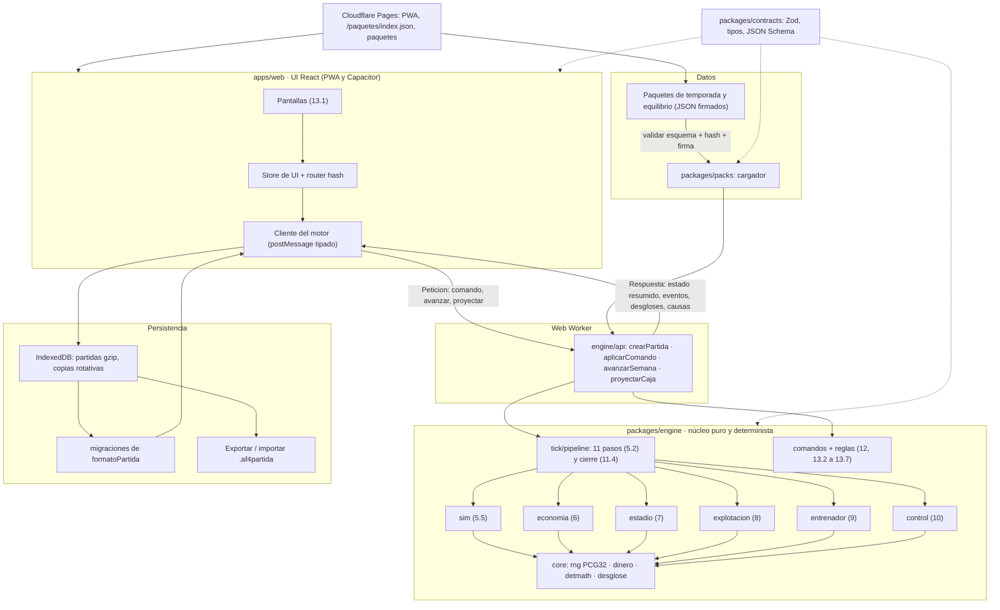
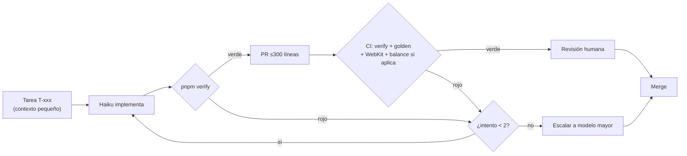

# Arquitectura de desarrollo: Android Futbol 4

| Campo | Valor |
|---|---|
| Documento | Propuesta de arquitectura de desarrollo, versión 1.0 |
| Especificación de referencia | `especificacion_gestion_futbol.md` v0.8 (en actualización a v0.9). Esta propuesta depende de la **estructura** de la especificación (módulos, entidades, orden del tick, sección 23), no de sus cifras. |
| Fecha | 23/10/2026 |
| Desarrollo | Agente de IA con **Claude Haiku** como implementador principal, supervisado por 1 o 2 personas; un modelo mayor para las tareas de arquitectura y depuración difícil (sección 13). |
| Estado | Propuesta para aprobar. Las decisiones están tomadas; las estimaciones están marcadas como tales. |

---

## 1. Resumen ejecutivo

1. **Un solo código en TypeScript estricto**: núcleo de simulación puro y determinista (`packages/engine`), sin UI ni dependencias, probado con los criterios de la sección 23 escritos como tests antes del código.
2. **UI web con React 19 + Vite**, publicada como **PWA en Cloudflare Pages**. Para que un amigo lo pruebe basta un enlace; funciona sin conexión y se instala desde el navegador.
3. **Android con Capacitor 8**, el mismo bundle web dentro de un APK/AAB. Se reparte por APK en GitHub Releases y por Google Play, primero en pruebas internas y cerradas y después en producción.
4. **Los datos van separados del código**: paquetes de temporada y de equilibrio en JSON versionado, validados con JSON Schema, firmados con Ed25519 y servidos desde hosting estático. Se actualizan como las "actualizaciones" de PC Fútbol, sin pasar por la tienda.
5. **Hecho para que lo programe Claude Haiku**: contratos tipados primero, especificación troceada por módulo, tareas de 300 líneas o menos con su test de aceptación, y CI con typecheck, lint, tests, golden hashes y simulación de N temporadas como red de seguridad.

---

## 2. Stack recomendado

### 2.1 Decisión

| Capa | Elección | Versión objetivo (verificada el 23/10/2026) | Por qué |
|---|---|---|---|
| Lenguaje | **TypeScript** en modo `strict` (más `noUncheckedIndexedAccess` y `exactOptionalPropertyTypes`) | 5.x | Es el lenguaje con tipos más presente en los datos de entrenamiento de modelos pequeños. Los tipos estrictos hacen de contrato y el compilador detecta antes de ejecutar muchos de los errores que comete Haiku. Un solo lenguaje sirve para núcleo, UI, herramientas de datos y scripts de CI. |
| Contratos y validación | **Zod 4**: esquemas de las entidades en TS; los tipos salen con `z.infer` y el JSON Schema con `z.toJSONSchema` | 4.x | Una sola fuente de verdad para tipos, validación en tiempo de ejecución y JSON Schema público de los paquetes. Es muy conocido y no usa generación de código ni decoradores. |
| Núcleo | TS puro, **sin dependencias de ejecución** | | Determinista, testeable en Node y portable a cualquier UI. |
| UI | **React 19** sin metaframework: sin Next ni librería de estado; un *store* propio de unas 60 líneas con `useSyncExternalStore` y un router por *hash* propio | React 19.3 (09/09/2026) | Es el framework de UI más común, y por eso donde Haiku comete menos errores. Sin SSR, sin RSC y sin "magia": funciones y props. Las pantallas de gestión son tablas y formularios y no necesitan nada más. |
| Estilos | CSS plano con variables (tokens) y CSS Modules de Vite | | Ninguna dependencia ni clases generadas que Haiku tenga que adivinar. |
| Build | **Vite** | 8.3 | Estándar, rápido y con configuración mínima. |
| PWA | **vite-plugin-pwa** (Workbox) en modo `prompt` | 1.x | Service worker generado, precacheo del bundle y aviso de actualización controlado. |
| Simulación sin bloquear la UI | **Web Worker** nativo con mensajes tipados (unión discriminada `Peticion`/`Respuesta`) | | "Simular hasta fin de temporada" no congela la pantalla. Sin librerías tipo Comlink. |
| Partidas guardadas | **IndexedDB** con la librería `idb` (unos 1 kB), comprimidas con `CompressionStream('gzip')` | | Funciona igual en la PWA y en el WebView de Capacitor. Exportar e importar como archivo `.af4partida`. |
| Android | **Capacitor 8**: `minSdk 24`, `targetSdk 36`, Node 22 o superior | 8.5 (Capacitor 9 previsto para finales de noviembre de 2026) | Mismo bundle, acceso nativo mínimo (compartir archivo, botón atrás, sistema de archivos) y cumple el *target API 36* que Google Play exige desde el 31/08/2026. |
| Tests | **Vitest** (unidad, aceptación y propiedades con `fast-check`) y **Playwright** (humo E2E en Chromium y WebKit) | | Mismo lenguaje y configuración que Vite. |
| Calidad | ESLint (`typescript-eslint` estricto con reglas propias de determinismo) y Prettier | | Lo comprueba la CI en cada cambio. |
| Monorepo | **pnpm workspaces**, sin Nx ni Turborepo | | Menos piezas. Bastan los scripts `pnpm -r`. |
| Firma de paquetes | `@noble/ed25519` (auditada y sin dependencias) | | La verificación funciona igual en todos los WebView, sin depender de que WebCrypto soporte Ed25519. |

Dependencias de ejecución de la app: `react`, `react-dom`, `zod`, `idb`, `@noble/ed25519` y `@capacitor/*` (core, app, filesystem, share). El resto son dependencias de desarrollo.

Política de versiones: se arranca con Capacitor 8.x. A Capacitor 9 se pasa cuando lleve un mes estable, en una tarea propia escalada a modelo mayor (sección 13.6). Renovate abre PR mensuales de dependencias.

### 2.2 Alternativas descartadas

| Alternativa | Motivo del descarte |
|---|---|
| **Kotlin + Jetpack Compose nativo** | Es la mejor opción si solo existiera Android, pero no hay enlace web para compartir. Cada corrección de código pasa por la tienda o por un APK, y no hay forma barata de probar en PC o iPhone. Además, el núcleo determinista quedaría atado a la JVM y los tests de equilibrio serían más lentos de montar. |
| **Flutter** | Buen rendimiento y un solo código, pero Dart aparece mucho menos que TS en los datos de entrenamiento: más errores de Haiku y más APIs alucinadas. La salida web de Flutter es pesada (CanvasKit) para un juego de tablas y la carga inicial de la PWA es peor. |
| **Godot / Unity** | Son motores pensados para gráficos y física, y este juego no tiene ni lo uno ni lo otro. Las tablas largas, la accesibilidad (13.9) y los formularios son costosos en estos motores. Exportar a web pesa decenas de MB. Unity además tiene licencia y editor binario, que un agente de IA maneja mal. |
| **TWA (Trusted Web Activity) en vez de Capacitor** | Las actualizaciones son instantáneas, pero depende de que Chrome esté instalado. Si el usuario borra los datos de Chrome, pierde la partida, y no hay acceso nativo para exportar partidas. Capacitor lleva el bundle dentro y funciona sin conexión desde la primera ejecución. |
| **Svelte / Solid / Vue** en vez de React | Técnicamente válidos y más ligeros, pero con menos presencia en los datos de entrenamiento que React. En un proyecto escrito por Haiku, lo que más pesa es que el modelo conozca bien la librería. |

---

## 3. Arquitectura por capas

### 3.1 Principios

1. **Núcleo puro (`engine`)**: no importa nada de UI, DOM, red, almacenamiento ni reloj. Prohibidos `Math.random`, `Date`, `performance`, `setTimeout` y el orden de iteración de objetos con claves numéricas. Lo hacen cumplir reglas de ESLint (`no-restricted-globals` y `no-restricted-properties`) y un test que recorre las importaciones.
2. **Estado como dato**: `EstadoPartida` es un objeto JSON serializable y normalizado (entidades por id, listas ordenadas por `codigo`). Guardar una partida es serializar ese estado.
3. **Comandos y ticks**: el jugador solo cambia el estado mediante `Comando`s validados (fichar, encargar obra, pedir préstamo, etc.) y el tiempo solo avanza con `avanzarSemana`. Cada comando inválido devuelve `Causa[]` legibles (13.9: "ninguna acción prohibida se puede confirmar").
4. **Fórmulas como funciones puras con desglose**: cada fórmula de la especificación es una función `(entrada tipada) => Desglose`, donde `Desglose = { valor, factores[] }`. El desglose alimenta directamente la UI (principio 7: "sin mecánicas ocultas").
5. **Pasos de tick como transformaciones**: cada uno de los 11 pasos de 5.2 es `(borrador, ctx) => void`. Muta un borrador clonado al empezar el tick y llama a fórmulas puras. Las fórmulas son fáciles de probar, la orquestación es simple y es rápido.
6. **Determinismo numérico**: `+ − × ÷` y `Math.sqrt` son exactos según IEEE 754 en todos los motores JS. `Math.pow`, `Math.exp` y `Math.log` **no** dan necesariamente el mismo resultado en todos los motores (V8 frente a JavaScriptCore). El núcleo usa `core/detmath.ts` (`expDet`, `logDet` y `powDet`, portados de fdlibm) para `10^(−d/25)`, los exponentes de 5.5.3 y similares. Los golden tests se ejecutan en Node y en WebKit para detectar divergencias.
7. **Aleatoriedad**: PCG32 (XSH RR, 64 bits de estado, implementado con `BigInt` para el estado) con un flujo por subsistema `k` (4.1). Decisión de arquitectura para completar la especificación: `initstate = semilla + k`, `initseq = k`. Se debe llevar a la sección 4.1 en v0.9.

### 3.2 Diagrama de capas



### 3.3 API pública del núcleo (contrato)

```ts
// packages/engine/src/api.ts — contrato estable; lo define el modelo mayor en la tarea T01
export function crearPartida(p: PaquetesCargados, o: OpcionesPartida): EstadoPartida;
export function aplicarComando(e: EstadoPartida, c: Comando): ResultadoComando;
export function avanzarSemana(e: EstadoPartida): ResultadoTick;           // un tick (5.2)
export function proyectarCaja(e: EstadoPartida, semanas: number): Proyeccion; // 6.1, sin sorteos
export function consultar<Q extends Consulta>(e: EstadoPartida, q: Q): RespuestaDe<Q>;

export type ResultadoComando =
  | { ok: true; estado: EstadoPartida; eventos: Evento[] }
  | { ok: false; causas: Causa[] };                  // p. ej. { codigo: 'VENTANA_CERRADA', ref: '11.3' }

export interface Desglose { valor: number; unidad: 'cent' | 'personas' | 'ratio' | 'puntos';
  factores: { clave: string; valor: number; ref: string }[] }      // ref = sección de la especificación
```

### 3.4 Capas y responsabilidades

| Capa | Paquete | Responsabilidad | Prohibido |
|---|---|---|---|
| Contratos | `packages/contracts` | Esquemas Zod de las entidades (4.2 a 4.27), enumeraciones (20), comandos, eventos, causas, paquetes, partida guardada. Genera JSON Schema. | Lógica de negocio. |
| Núcleo | `packages/engine` | Fórmulas, pasos del tick, comandos, reglas y consultas con desglose. | E/S, reloj, aleatoriedad fuera de `core/rng`, React. |
| Datos | `packages/packs` y `packs/` | Carga, validación, verificación de hash y firma, resolución de compatibilidad y aplanado de parámetros. | Lógica de simulación. |
| Persistencia | `apps/web/src/persistencia` | IndexedDB, compresión, copias rotativas, exportación e importación, migraciones (las migraciones puras están en `packages/engine/src/migraciones`). | Cambiar reglas del juego. |
| UI | `apps/web` | Pantallas, navegación por modo y presentación de desgloses. | Calcular cifras de juego: toda cifra viene del núcleo. |
| Nativo | `apps/web/android` (Capacitor) | Envoltorio Android, plugins mínimos. | Código de juego. |

---

## 4. Estructura del repositorio (monorepo)

```
android-futbol-4/
├─ CLAUDE.md                     # Reglas para el agente (sección 13.1). Protegido.
├─ package.json                  # scripts: verify, test, golden:update, spec:split, packs:*
├─ pnpm-workspace.yaml
├─ tsconfig.base.json            # strict + noUncheckedIndexedAccess + exactOptionalPropertyTypes
├─ eslint.config.js              # incluye reglas de determinismo para packages/engine
├─ .github/
│  ├─ workflows/                 # ci.yml, balance.yml, packs.yml, release-web.yml, release-android.yml
│  └─ CODEOWNERS                 # rutas protegidas → revisión humana obligatoria
├─ docs/
│  ├─ spec/
│  │  ├─ especificacion.md       # Especificación maestra (copia de la versión aprobada)
│  │  ├─ mapa-secciones.json     # sección → archivo de módulo (lo usa spec:split)
│  │  └─ modulos/                # GENERADO: un .md por módulo + su bloque de la sección 23
│  ├─ tareas/                    # T-xxx.md (plantilla en 13.3); backlog del Anexo A
│  ├─ decisiones/                # ADR cortos (ADR-001 stack, ADR-002 PCG32 initseq, …)
│  └─ preguntas.md               # Dudas de especificación que el agente no puede resolver
├─ packages/
│  ├─ contracts/                 # Zod → tipos + JSON Schema (schemas/*.schema.json generados)
│  │  └─ AGENTS.md
│  ├─ engine/
│  │  ├─ AGENTS.md               # contrato del núcleo y reglas de determinismo
│  │  ├─ src/
│  │  │  ├─ core/                # rng.ts (PCG32, Poisson), dinero.ts, detmath.ts, desglose.ts, orden.ts
│  │  │  ├─ calendario/          # meses y ticks, semanas de jornada, círculo, ventanas
│  │  │  ├─ sim/                 # titulares, fuerza, partido, clasificacion, lesiones, forma
│  │  │  ├─ economia/            # libro, liquidacion, plazos, ingresos/*, gastos/*, prestamos,
│  │  │  │                       # impuestos, reparto-tv, descubierto, amortizacion, clausulas
│  │  │  ├─ estadio/             # secciones, obras, aforo, mantenimiento, cesped
│  │  │  ├─ explotacion/         # demanda, palcos, hospitality, merchandising, patrocinio,
│  │  │  │                       # museo, restauracion, eventos
│  │  │  ├─ entrenador/          # objetivos, reputacion, honorarios, directiva, ofertas, renovaciones
│  │  │  ├─ control/             # indicadores, sanciones, techo de gasto
│  │  │  ├─ temporada/           # pretemporada, cierre 11.4, ascensos y promoción 15.6
│  │  │  ├─ reglas/              # validadores de comandos → Causa[] (sección 12)
│  │  │  ├─ comandos/            # un archivo por comando
│  │  │  ├─ tick/                # pipeline.ts (orquestación de los 11 pasos)
│  │  │  ├─ consultas/           # vistas para la UI con desglose
│  │  │  ├─ migraciones/         # migrar(partida, de, a)
│  │  │  └─ api.ts
│  │  └─ test/
│  │     ├─ aceptacion/          # sección 23 como tests (protegido): 23.1-datos.spec.ts …
│  │     ├─ golden/              # hashes de movimientos por semilla (protegido)
│  │     ├─ fixtures/            # club de referencia, partidas guardadas por versión
│  │     └─ unidad/              # tests libres del agente
│  └─ packs/                     # cargador, verificador de firma, compatibilidad, aplanado
├─ packs/                        # FUENTE de los paquetes de datos
│  ├─ temporada-2026-27/
│  │  ├─ fuente/temporada-2026-27.xlsx   # lo editan personas no programadoras
│  │  ├─ datos/*.json                    # GENERADO desde el xlsx (no editar a mano)
│  │  └─ manifest.json                   # GENERADO (hashes); la firma la añade la CI
│  └─ equilibrio-base/
│     ├─ fuente/equilibrio.xlsx
│     ├─ parametros/*.json               # GENERADO
│     └─ manifest.json
├─ apps/
│  └─ web/
│     ├─ AGENTS.md
│     ├─ src/
│     │  ├─ pantallas/           # una carpeta por pantalla de 13.1
│     │  ├─ componentes/         # Tabla, Desglose, Importe, Aviso, Confirmacion…
│     │  ├─ motor-cliente/       # worker.ts + cliente tipado
│     │  ├─ persistencia/        # idb, gzip, exportar e importar
│     │  ├─ actualizaciones/     # comprobación de paquetes y de versión de app
│     │  └─ store.ts, router.ts, visibilidad-modos.ts
│     ├─ android/                # proyecto Capacitor (generado por cap add android)
│     └─ capacitor.config.ts
└─ tools/
   ├─ spec-split/                # trocea docs/spec/especificacion.md
   ├─ packs-cli/                 # compilar (xlsx→json), validar, hashear, firmar, publicar
   ├─ generador/                 # pool ficticio (15.5) → escribe el xlsx inicial
   ├─ balance/                   # simula N temporadas y escribe el informe 14.9 / 5.5.7
   └─ guardas/                   # comprueba rutas protegidas y tamaño de los cambios
```

### 4.1 Mapa de la especificación a los módulos de código

| Sección de la especificación | Módulo de código | Archivo de especificación troceada |
|---|---|---|
| 0 a 3 (convenciones, principios) | `CLAUDE.md`, `engine/core`, reglas de ESLint | `modulos/00-principios.md` |
| 4 (modelo de datos), 20 (enumeraciones) | `packages/contracts` | `modulos/01-modelo-datos.md` |
| 4.1 (redondeo, aleatoriedad, caja/resultado) | `engine/core/dinero.ts`, `rng.ts`, `economia/libro.ts` | `modulos/01-modelo-datos.md` |
| 5.1 a 5.4, 11.3 | `engine/calendario` | `modulos/02-calendario.md` |
| 5.2 (orden del tick), 11.4 (cierre) | `engine/tick/pipeline.ts`, `engine/temporada/cierre.ts` | `modulos/02-calendario.md` |
| 5.5, 9.12 (forma, moral, entrenamiento, lesiones) | `engine/sim` | `modulos/03-simulacion.md` |
| 6.1, 6.5, 6.10 a 6.12 (caja, plazos, liquidación, descubierto) | `engine/economia/libro.ts`, `liquidacion.ts`, `plazos.ts`, `descubierto.ts` | `modulos/04-caja.md` |
| 6.2 (ingresos) | `engine/economia/ingresos/*` | `modulos/05-ingresos.md` |
| 6.3, 6.4, 6.6 (gastos, amortización, cláusulas) | `engine/economia/gastos/*`, `amortizacion.ts`, `clausulas.ts` | `modulos/06-gastos.md` |
| 6.7, 6.8 (préstamos, impuestos) | `engine/economia/prestamos.ts`, `impuestos.ts` | `modulos/07-prestamos-impuestos.md` |
| 6.9 (reparto audiovisual) | `engine/economia/reparto-tv.ts` | `modulos/08-reparto-tv.md` |
| 7 (estadio y obras) | `engine/estadio` | `modulos/09-estadio.md` |
| 8 (monetización) | `engine/explotacion` | `modulos/10-explotacion.md` |
| 9 (entrenador, salvo 9.12) | `engine/entrenador` | `modulos/11-entrenador.md` |
| 10 (control económico) | `engine/control` | `modulos/12-control.md` |
| 12 (reglas y casos límite) | `engine/reglas`, `engine/comandos` | `modulos/13-reglas.md` |
| 13 (pantallas y flujos) | `apps/web/src/pantallas`, `visibilidad-modos.ts` | `modulos/14-pantallas.md` |
| 14 (parámetros de equilibrio) | `packs/equilibrio-base`, `tools/balance` | `modulos/15-parametros.md` |
| 15, 18 (carga de datos, contenido) | `packs/temporada-*`, `tools/generador`, `packages/packs` | `modulos/16-carga-datos.md` |
| 16, 17 (abiertas, lagunas) | *Flags* en `Partida` (A-07, A-10, A-13) y `bloqueos.json` (B-1 a B-7) | `modulos/17-abiertas.md` |
| 23 (checklist) | `engine/test/aceptacion/23.x-*.spec.ts` | Cada bloque 23.x se añade al final de su módulo |

---

## 5. Formato de datos

### 5.1 Dos tipos de paquete

| Tipo | Contenido | Cuándo cambia | Ejemplo de id |
|---|---|---|---|
| **Temporada** (`temporada`) | Competiciones, clubes (P01 a P20, S01 a S22, T01 a T03), estadios y secciones, jugadores, contratos, cláusulas, entrenadores, personal técnico, derechos, tabla de Promanager (15.4) y textos (nombres ficticios). | Una vez por temporada real, más correcciones. | `af4.temporada.2026-27` |
| **Equilibrio** (`equilibrio`) | Todas las cifras de la sección 14 y las constantes [D] de las secciones 5 a 10: `p_empate`, ventaja de campo, pools, tipos de interés, umbrales, ocupaciones máximas, costes de obra, etc. | Cuando se ajusta el equilibrio, que puede ser semanal durante la beta. | `af4.equilibrio.base` |

Regla: **ninguna cifra [D], [E] o [NV] de la especificación vive en el código**. El código solo contiene estructura (orden del tick, fórmulas) y constantes de sistema que la especificación declara así (12 meses, 52 semanas, máximo de 4 préstamos activos). Cada parámetro guarda su etiqueta de confianza y su sección de referencia:

```json
// packs/equilibrio-base/parametros/simulacion.json (fragmento)
{
  "p_empate":         { "valor": 0.26, "etiqueta": "D", "ref": "5.5.3" },
  "ventaja_campo":    { "valor": 5,    "etiqueta": "D", "ref": "5.5.3" },
  "lambda_base_goles":{ "valor": 1.35, "etiqueta": "D", "ref": "5.5.3" },
  "peso_posicion":    { "valor": { "portero": 1.0, "defensa": 1.0, "centrocampista": 1.1, "delantero": 1.2 },
                        "etiqueta": "D", "ref": "5.5.2" }
}
```

El cargador aplana esto a un objeto `Parametros` tipado (`parametros.simulacion.p_empate: number`) que es lo único que ve el núcleo.

### 5.2 Manifiesto de paquete (ejemplo)

```json
{
  "$schema": "https://af4.pages.dev/esquemas/manifest-1.schema.json",
  "id": "af4.temporada.2026-27",
  "tipo": "temporada",
  "version": "1.3.0",
  "formato": 1,
  "motor": { "min": "0.4.0", "max": "0.x" },
  "requiere": [{ "id": "af4.equilibrio.base", "version": ">=1.0.0 <2.0.0" }],
  "canal": "estable",
  "titulo": "Temporada 2026/27 (actualización de octubre)",
  "notas": "Corrige salarios de S07 y añade el club de reserva T03.",
  "fecha_referencia": "2026-10-22",
  "fuente": "Pool ficticio generado con semilla 7 (15.5); revisión manual de nombres (18.1)",
  "especificacion": "0.9",
  "aplicable_a_partidas_en_curso": false,
  "archivos": [
    { "ruta": "datos/clubes.json",    "sha256": "9f2c…e1", "bytes": 48211 },
    { "ruta": "datos/jugadores.json", "sha256": "41aa…7c", "bytes": 612904 },
    { "ruta": "datos/contratos.json", "sha256": "c0d3…19", "bytes": 233118 }
  ],
  "firma": { "alg": "ed25519", "clave": "af4-2026-a", "valor": "base64…" }
}
```

- `version` sigue SemVer. **MAJOR**: cambia el formato y exige un motor nuevo (`motor.min`). **MINOR**: datos nuevos (clubes, jugadores) compatibles. **PATCH**: correcciones de cifras.
- `formato` es la versión del esquema de los archivos (`manifest-1`, `jugador-1`…). Lo publica `packages/contracts` en `/esquemas/`.
- La firma cubre el manifiesto canónico sin el campo `firma` (JSON con claves ordenadas). Los hashes de `archivos` encadenan la integridad de cada archivo.

### 5.3 Validación automática de paquetes (`pnpm packs:validar`)

Cuatro niveles. La CI rechaza el paquete si falla cualquiera.

1. **Esquema**: cada archivo contra su JSON Schema (tipos, rangos de la sección 4: `calidad` de 1 a 100, `aforo_total` de 5.000 a 120.000, importes enteros en céntimos, enumeraciones de la sección 20).
2. **Referencias**: los ids y códigos existen (`contrato.jugador_id`, `cláusula.contrato_id`), son únicos (`codigo` de jugador único en la partida) y las cardinalidades de 4.22 se respetan (un estadio por club, como máximo 4 préstamos activos).
3. **Reglas de carga** (15.3 y 15.5): 20 clubes en Primera y 22 en Segunda, de 26 a 30 jugadores por club con el reparto por posición, de 18 a 25 inscritos (12.1), límite de no comunitarios (12.2), suma de secciones = `aforo_total`, palcos múltiplo de 10, contenido ficticio (lista de nombres reales vetados, 18.1).
4. **Humo de simulación**: `crearPartida` y una temporada completa con 3 semillas sin excepciones ni invariantes rotos (caja = suma de movimientos con `afecta_caja`, repartos que suman el pool exacto).

Los errores se informan con la ubicación de la fuente: `temporada-2026-27.xlsx › Jugadores › fila 214 › columna salario: 2.300.000.000 > máximo 2.000.000.000 (4.9)`.

### 5.4 Partidas guardadas y migración

```ts
interface PartidaGuardada {
  formatoPartida: number;                 // entero; sube con cualquier cambio de EstadoPartida
  motorVersion: string;                   // versión de la app que guardó
  paquetes: { id: string; version: string; sha256: string }[];  // con qué datos se creó
  semilla: string;                        // bigint en texto
  estado: EstadoPartida;                  // incluye una COPIA de los parámetros en uso
  registro: { semana: number; temporada: number; comando: Comando }[];  // desde el último cierre de temporada
}
```

- **La partida es autocontenida**: lleva una copia de los datos y parámetros con los que se juega, así que actualizar un paquete nunca rompe una partida en curso.
- Política de aplicación de paquetes a partidas en curso:
  - **Temporada**: solo afecta a partidas nuevas. Al cerrar una temporada (13.8) se ofrece "aplicar la actualización de plantillas", que solo funciona si el paquete trae un bloque de diferencias compatible. Por defecto no se aplica.
  - **Equilibrio**: si `aplicable_a_partidas_en_curso = true`, se aplica **en la semana 1 de la siguiente temporada**, nunca a mitad, para que cada temporada sea reproducible con un solo juego de parámetros. Se informa al jugador.
- **Migraciones**: `engine/src/migraciones/NNNN-de-a.ts` son funciones puras `(estado vN) => estado vN+1` encadenadas al cargar. Cada versión de formato deja una partida de muestra en `test/fixtures/partidas/vN.json`. La CI carga todas las anteriores, las migra y simula 4 semanas.
- **Reproducibilidad**: `semilla + paquetes + registro de comandos + motorVersion` permite rehacer una temporada exacta. El botón "Informar de un error" exporta esto, sin datos personales.

---

## 6. Sistema de actualización rápida

### 6.1 Actualizaciones de datos (sin tienda)

```mermaid
sequenceDiagram
  participant Ed as Editor (xlsx)
  participant GH as GitHub (PR)
  participant CI as GitHub Actions
  participant CDN as Cloudflare Pages
  participant App as App (PWA o Android)
  Ed->>GH: sube xlsx modificado
  GH->>CI: packs.yml
  CI->>CI: compilar xlsx→json, validar 4 niveles, balance rápido (50 semillas)
  CI-->>GH: informe en el PR (diferencias de datos e indicadores 14.9)
  GH->>CI: merge a main (canal beta) o tag pack-* (canal estable)
  CI->>CI: hashear y firmar Ed25519 (clave en secreto)
  CI->>CDN: /paquetes/<id>/<version>/… e index.json
  App->>CDN: GET /paquetes/index.json (al abrir, como mucho 1 vez/día)
  App->>App: elige la versión compatible más alta, descarga, verifica sha256 y firma
  App->>App: guarda en IndexedDB; se usa en partidas nuevas o en la semana 1
```

- `index.json` lista, por canal (`beta`, `estable`), los paquetes con `version`, `motor.min/max` y la URL del manifiesto. La app solo acepta paquetes firmados con una clave de su lista embebida. Se embeben dos claves, la activa y la de reserva, para poder rotarlas.
- La app **lleva dentro** el último paquete estable de cuando se compiló, así que funciona sin red desde la primera ejecución.
- Pantalla "Actualizaciones": paquete instalado, disponibles, notas y opción de volver a la versión anterior. Se conservan las dos últimas versiones de cada paquete.

### 6.2 Actualizaciones de código

| Canal | Mecanismo | Tiempo hasta el usuario |
|---|---|---|
| **PWA** | El service worker (vite-plugin-pwa en modo `prompt`) descarga el bundle nuevo en segundo plano. La app muestra "Nueva versión disponible: guardar y actualizar". **Nunca se recarga sola a mitad de partida**: antes de aplicar la versión fuerza un guardado. | Minutos después del despliegue |
| **Android, Google Play** | AAB subido por la CI a la pista *internal* y, tras validarlo, promocionado a *closed* o *production*. | Interna: casi inmediato. Producción: según la revisión de Google |
| **Android, APK directo** | APK firmado en GitHub Releases. La app consulta `/app/latest.json` y, si hay versión mayor, enlaza al APK. | Inmediato tras publicar |
| **Android, actualización del bundle web sin tienda (OTA)** | **No en v1.** La política de Google Play permite descargar código que corre en un intérprete, como JavaScript en un WebView, así que es viable más adelante (fase 6, Capgo autoalojado). En v1 se descarta: añade un sistema de rollback y firmas de código que no compensa, porque los paquetes de datos ya cubren la mayoría de las actualizaciones rápidas. | — |

### 6.3 Política de compatibilidad

1. **App ↔ paquete**: la app declara `motorVersion` (SemVer). Un paquete se instala solo si `motor.min ≤ motorVersion` y la versión cumple `motor.max`. Si no hay ninguno compatible, la app usa el paquete que lleva dentro y avisa de que debe actualizarse.
2. **App ↔ partida**: una app abre cualquier partida con `formatoPartida ≤` el suyo (migrando hacia delante). Una partida de formato mayor se rechaza con el mensaje "actualiza la app".
3. **Ventana de soporte**: los paquetes estables se publican compatibles con las **dos últimas versiones MINOR** del motor. Las migraciones de partidas se conservan siempre.
4. **Determinismo entre versiones**: un PATCH del motor no puede cambiar los golden hashes. Si los cambia, es una corrección de reglas: sube la MINOR y se anota en el registro de cambios.

---

## 7. Compartir

### 7.1 Canales

| Canal | Para quién | Qué hace falta |
|---|---|---|
| **Enlace a la PWA** (`https://af4.pages.dev` o dominio propio) | Cualquiera, en móvil o PC. **Canal principal para compartir.** | Nada: se abre el enlace y se juega. "Añadir a pantalla de inicio" la instala. |
| **Enlace de vista previa por PR** (`https://<rama>.af4.pages.dev`) | Probadores de una función concreta. | Cloudflare Pages crea uno por cada PR. |
| **APK por enlace** (GitHub Releases o QR) | Amigos con Android que prefieren app nativa. | Permitir "instalar apps desconocidas" la primera vez. Ver la nota de verificación de desarrolladores más abajo. |
| **Google Play, prueba interna** | Equipo y amigos cercanos (lista de correos). | Cuenta de Play (25 USD) y añadir el correo del probador. |
| **Google Play, prueba cerrada** | Grupo de beta. **Obligatoria antes de producción** en cuentas personales: 12 probadores como mínimo, dados de alta durante 14 días seguidos. | Hay que empezarla pronto (fase 4) para que los 14 días no retrasen el lanzamiento. |
| **Google Play, producción** | Público. | Tras cumplir la prueba cerrada y pasar la revisión. |

**Verificación de desarrolladores de Android (afecta al APK directo).** Desde el 30/09/2026, en Indonesia, Singapur y Tailandia, los dispositivos Android certificados solo instalan apps de desarrolladores registrados. Google prevé extenderlo a todo el mundo en 2027. Decisión: **registrar la clave de firma del proyecto en Android Developer Console desde la fase 2**. La cuenta de distribución limitada es gratuita, sin documento de identidad y permite hasta 20 dispositivos; con la cuenta de Play ya pagada se usa la de distribución completa. Así el APK por enlace sigue funcionando en 2027. La PWA no se ve afectada.

### 7.2 "Que un amigo lo pruebe en 1 minuto"

1. Se le envía el enlace `https://af4.pages.dev/?p=nueva` o un QR.
2. La PWA carga (bundle inicial objetivo: **menos de 400 kB gzip** sin el paquete de datos; paquete de temporada de 0,5 a 1 MB gzip, precargado en segundo plano).
3. Pantalla de inicio con **"Partida rápida"**: club aleatorio de Primera, modo Coach y semilla aleatoria, sin registro ni cuenta. Un tutorial de 3 tarjetas explica Avanzar semana, Caja y Desglose.
4. En 60 segundos el amigo está avanzando semanas. Si le gusta, "Instalar" (PWA) o "Descargar para Android" (APK o Play).
5. Botón "Enviar comentarios": abre un formulario externo (Google Forms o un correo `mailto:`) con versión, paquete y semilla rellenados. No hay telemetría ni servidor propio en v1.

---

## 8. Calidad

### 8.1 Pirámide de pruebas

| Nivel | Herramienta | Qué cubre | Quién lo escribe |
|---|---|---|---|
| **Aceptación (golden de la sección 23)** | Vitest, `test/aceptacion/23.x-*.spec.ts` | Cada casilla de la sección 23 es un `it('AC-23.3-04 …')` con el valor y la tolerancia exactos de la especificación (1 céntimo, 1 persona). Las casillas "bloqueado por B-n" se escriben como `it.todo` con el bloqueo en el nombre. | Modelo mayor o persona, **antes** de la tarea de implementación. Protegido. |
| **Golden de determinismo** | Vitest | Con las semillas 1, 42 y 2026, SHA-256 del JSON canónico de todos los movimientos, la clasificación y las lesiones tras 1 y 3 temporadas (AC-23.2-05). Solo se cambia con `pnpm golden:update`, en un PR que lo justifique y con aprobación humana. | Se genera una vez y está protegido. |
| **Propiedades** | `fast-check` | Invariantes: la caja es la suma de los movimientos con `afecta_caja`; los repartos con mayor resto suman exacto; los marcadores coinciden con el resultado; la plantilla nunca supera 25 inscritos; ningún importe deja de ser entero. | Agente (tareas H). |
| **Unidad** | Vitest | Cada fórmula con 3 a 5 casos, incluidos los límites. | Agente. |
| **Equilibrio** | `tools/balance` | 200 temporadas (semillas 1 a 200, como en 14.9) con estrategias tipo: conservadora, agresiva, sin obras. Comprueba los criterios 1 a 8 de 14.9, 5.5.7 y los porcentajes de 14.8. Escribe `informe-balance.md` y `.json`. | Se ejecuta en la CI. |
| **Determinismo entre motores** | Playwright con Node y WebKit | El golden de la semilla 42, 1 temporada, en Chromium y en WebKit debe dar el mismo hash. Detecta usos de `Math.pow` y similares. | CI. |
| **E2E de humo** | Playwright | Partida rápida, avanzar 5 semanas, guardar, recargar, cargar y comparar el saldo. Pantallas por modo (AC-23.9-01). | Agente con plantilla. |
| **Rendimiento** | Vitest bench | Presupuesto: 1 tick con los 45 clubes en menos de 30 ms en Node de la CI (objetivo de menos de 80 ms en un Android de gama media); temporada completa en menos de 3 s. | CI (avisa si empeora más de un 20 %). |

### 8.2 CI/CD con GitHub Actions

| Workflow | Disparador | Pasos |
|---|---|---|
| `ci.yml` | Cada push y PR | `pnpm install --frozen-lockfile`; `pnpm verify` = `typecheck` + `lint` + `test` (unidad, propiedades, aceptación, golden) + `spec:check` (los módulos troceados están al día) + `packs:validar` + `guardas` (rutas protegidas, tamaño del cambio); `build` de la PWA; Playwright de humo (Chromium y WebKit); despliegue de la vista previa en Cloudflare Pages y comentario con la URL en el PR. |
| `balance.yml` | Cada noche; PR que toquen `packs/equilibrio-*`, `engine/src/{sim,economia,explotacion}` o con la etiqueta `balance` | `tools/balance` con 200 semillas (50 en un PR); publica el informe como artefacto y comentario; **falla** si un criterio de 14.9 que antes se cumplía deja de cumplirse (regresión). |
| `packs.yml` | Cambios en `packs/**` | Compilar xlsx→json y comprobar que el JSON del commit coincide (si no, falla con "ejecuta `pnpm packs:compilar`"); validar; diferencias legibles de datos en el PR. En `main` firma y publica en el canal `beta`; con el tag `pack-<id>-<ver>` publica en `estable`. |
| `release-web.yml` | Tag `v*` | Build y despliegue a producción en Cloudflare Pages; actualiza `/app/latest.json`. |
| `release-android.yml` | Tag `v*` | `pnpm build` → `npx cap sync android` → Gradle `bundleRelease` y `assembleRelease` firmados con el *keystore* guardado en secretos → AAB a Play, pista *internal* (Gradle Play Publisher con cuenta de servicio) → APK a GitHub Releases. |

### 8.3 Entornos

| Entorno | URL | Paquetes | Uso |
|---|---|---|---|
| Local | `localhost:5173` | Locales (`packs/` sin firmar; el modo desarrollo acepta paquetes sin firma) | Desarrollo y pruebas del agente. |
| Vista previa | `<rama>.af4.pages.dev` | `beta` | Revisión de cada PR. |
| Beta | `beta.af4.pages.dev` y Play interna o cerrada | `beta` | Probadores. |
| Producción | `af4.pages.dev` (o dominio) y Play producción | `estable` | Público. |

---

## 9. Herramienta de edición de datos para no programadores

**Decisión: hoja de cálculo (xlsx) → JSON con script.** No se desarrolla un editor propio.

- **Por qué**: cualquiera sabe usar Excel, LibreOffice o Google Sheets (descargando como xlsx). Los datos son esencialmente tablas: 45 clubes, unos 1.200 jugadores, contratos y parámetros. No hay ninguna UI de edición que mantener. Un editor web propio costaría de 3 a 5 semanas y competiría con el juego por el tiempo del equipo.
- **Estructura del libro**: una hoja por entidad de carga (15.2): `Clubes`, `Estadios`, `Secciones`, `Jugadores`, `Contratos`, `Clausulas`, `Entrenadores`, `Personal`, `Derechos`, `Promanager`. Más una hoja `Parametros` en el libro de equilibrio, con las columnas `clave | valor | etiqueta | ref | nota`.
  - La fila 1 tiene los nombres de campo de la especificación. La fila 2 es una descripción y está protegida.
  - Las columnas de enumeración usan listas desplegables, generadas por `packs-cli plantilla` a partir de los esquemas.
  - Los importes se escriben **en euros** con decimales y el script los convierte a céntimos enteros, con el redondeo de 4.1.
- **Flujo**:
  1. La persona editora abre el xlsx y lo modifica.
  2. Lo sube a GitHub, desde la web en "Upload file" o con GitHub Desktop.
  3. La CI compila, valida y comenta en el PR: errores con hoja, fila y columna; diferencias legibles (`S07 · salario de S07-J12: 0,9 M€ → 1,1 M€`) e indicadores de equilibrio.
  4. Una persona del equipo aprueba y fusiona.
- **Fuente de verdad**: el xlsx. El JSON generado se versiona para tener diferencias revisables en git y lo comprueba la CI. **Nadie edita el JSON a mano**, tampoco el agente.
- **Generador**: `tools/generador` crea el xlsx inicial del pool ficticio (15.5) con una semilla. Las personas editoras retocan sobre ese resultado.
- **Prueba rápida sin CI**: la pantalla oculta "Laboratorio" (en vista previa y beta) permite arrastrar un xlsx o un paquete JSON local y empezar una partida con él. Usa el mismo compilador, que corre en el navegador.

---

## 10. Plan de entregas por fases

> **Estimación orientativa**: semanas de calendario para 1 o 2 personas que supervisan, revisan y prueban, con Claude Haiku implementando las tareas H y un modelo mayor en las tareas M. Incluye el tiempo de revisión humana. No es un compromiso.

| Fase | Contenido | Criterio de salida | 1 persona | 2 personas |
|---|---|---|---|---|
| **F0 · Fundaciones** | Monorepo, CI, CLAUDE.md y AGENTS.md, especificación troceada, `contracts` (entidades de la sección 4), tests de aceptación de la sección 23 escritos (en rojo o `todo`), club de referencia de prueba, `core` (dinero, PCG32, detmath), PWA vacía desplegada, Capacitor generando APK. | `pnpm verify` en verde con los tests de aceptación marcados como pendientes; APK y URL vacíos publicados. | 2–3 | 1,5–2 |
| **F1 · Núcleo de temporada** | Calendario (5.1 a 5.4, 11.3), simulación 5.5 completa, clasificación, lesiones, demanda 8.2, libro y liquidación 6.5, ingresos principales (derechos, comercialización, taquilla, abonos, palcos, hospitality, restauración de día de partido, vallas), gastos principales (salarios, personal, honorarios, mantenimiento), descubierto, cierre 11.4 básico, ascensos y promoción 15.6, generador y paquete v0, CLI de balance. | AC de 23.1, 23.2, 23.6 y la parte de 23.3 no bloqueada en verde; 200 temporadas sin errores; golden fijado. | 5–6 | 3–4 |
| **F2 · MVP jugable** | Modo **Coach**. Pantallas: Inicio, Calendario, Clasificación, Plantilla (lectura), Entrenamientos, Caja y finanzas, Ingresos, Gastos, Objetivos, Carrera (lectura), Fin de temporada. Componente de desglose. Objetivos, reputación y confianza (9.3 a 9.7). Guardar, cargar, exportar e importar. PWA instalable, APK por enlace, registro de desarrollador. | **Se puede compartir**: un amigo juega 2 temporadas desde un enlace. AC de 23.7 no bloqueados en verde. | 4–5 | 2,5–3 |
| **F3 · Economía y estadio completos** | Préstamos, impuestos, reparto 6.9 completo, patrocinio y naming, merchandising, museo y tours, obras y aforo, césped, eventos y conciertos, seguros y médico, control económico (sección 10), proyección de caja de 8 semanas. **Sistema de paquetes firmados y actualización**, pipeline xlsx. | AC de 23.3, 23.4, 23.5 y 23.8 no bloqueados en verde; primer paquete publicado por CDN y recibido por la app. | 5–6 | 3–4 |
| **F4 · Entrenador y modos** | Ofertas, renovaciones, despidos, ajustes de la directiva (9.8 a 9.13), modos Manager, President, Total y Promanager, visibilidad por modo (13.1), techo de gasto (10.4). Se empieza la **prueba cerrada de Play** (14 días en paralelo). | AC-23.9-01 en verde; 12 probadores o más activos. | 3–4 | 2–3 |
| **F5 · Mercado** (**bloqueado por B-1**) | Fichajes, ventas, cesiones y rescisiones (13.2 y 13.3), IA mínima de los clubes no controlados. Solo cuando producto cierre B-1. | Flujos de 13.2 y 13.3 con sus AC. | 3–4 | 2–3 |
| **F6 · Pulido y lanzamiento** | Accesibilidad (13.9), rendimiento en gama baja, ajuste de equilibrio con informes, textos, Play producción. Valorar OTA del bundle. | 14.9 cumplido; publicada en Play. | 2–3 | 1,5–2 |
| **Total** | | | **24–31** | **15–21** |

El **MVP compartible** (F0 a F2) se estima en **11–14 semanas con 1 persona** o **7–9 con 2** (estimación).

---

## 11. Riesgos principales y mitigación

| # | Riesgo | Mitigación |
|---|---|---|
| 1 | **Especificación abierta o bloqueada** (B-1 a B-7, decisiones A-xx, cifras cambiando en v0.9). | Las cifras van en los paquetes de equilibrio y no en el código. Un archivo `bloqueos.json` desactiva las funciones bloqueadas, con `it.todo` en sus tests. El plan deja Mercado (B-1) en una fase aparte. `spec:split` regenera los módulos cuando cambia la especificación, y la CI avisa de qué tareas citan secciones modificadas. |
| 2 | **Errores sutiles de un modelo pequeño**: fórmulas mal transcritas, redondeos, orden de liquidación. | Contratos tipados antes del código, tests de aceptación escritos por el modelo mayor o por una persona y protegidos, golden hashes, propiedades, balance de 200 temporadas en la CI y tareas de 300 líneas o menos con revisión humana. Escalado tras 2 intentos fallidos (13.6). |
| 3 | **Se pierde el determinismo**: `Math.pow` distinto entre motores, orden de claves, `Date`. | `detmath` propio, ESLint con globales prohibidas en `engine`, colecciones como listas ordenadas por `codigo`, golden en Node y WebKit, test de importaciones del núcleo. |
| 4 | **El equilibrio no converge** (14.8 y 14.9). | CLI de balance desde F1, informe en cada PR que toque parámetros, parches de equilibrio por CDN sin publicar la app y partidas que adoptan el parche en la semana 1. |
| 5 | **Pérdida o incompatibilidad de partidas**: almacenamiento del WebView o de la PWA desalojado, cambios de formato. | `navigator.storage.persist()`, 3 copias rotativas y guardado automático en cada cierre de mes, exportación a archivo (Share en Android), migraciones encadenadas probadas con partidas de muestra de cada versión. |
| 6 | **Fricción de distribución en Android**: 12 probadores durante 14 días, *target API* anual (36 desde el 31/08/2026), verificación de desarrolladores para APK en 2027. | La PWA es el canal principal para compartir, la prueba cerrada empieza en F4, el desarrollador se registra en F2 y Capacitor se actualiza cada año (Capacitor 8 ya apunta a la API 36). |

---

## 12. Costes de infraestructura orientativos

| Concepto | Coste | Nota |
|---|---|---|
| Hosting de PWA y paquetes: Cloudflare Pages, plan gratuito | **0 €** | Límites del plan gratuito: 500 builds al mes, 20.000 archivos por sitio y 25 MiB por archivo. Un paquete de temporada pesa alrededor de 1 MB, así que hay mucho margen. |
| Repositorio y CI: GitHub | **0 €** | Los repositorios públicos no gastan minutos con los *runners* estándar. Para uno privado hay una cuota mensual gratuita de minutos (no se ha podido verificar la cifra vigente; consultar la página de facturación de GitHub Actions). El build de Android de unos 6 minutos y el balance nocturno de unos 5 minutos caben con holgura en la práctica. |
| Cuenta de desarrollador de Google Play | **25 USD, pago único** | Verificado en la ayuda de Play Console. Las cuentas personales necesitan la prueba cerrada (12 probadores durante 14 días). |
| Android Developer Console (verificación para APK fuera de Play) | **0 €** (distribución limitada, hasta 20 dispositivos) o incluido / 25 USD (distribución completa) | Necesario fuera de Play desde 2027 en todo el mundo (desde el 30/09/2026 en Indonesia, Singapur y Tailandia). |
| Dominio propio (opcional) | unos 10–15 € al año | `af4.pages.dev` es gratis y suficiente. |
| API de Claude (Haiku más un modelo mayor ocasional) | Variable | Depende del plan contratado y del volumen. No se estima aquí. |
| **Total de infraestructura del primer año** | **unos 25 USD** (más el dominio si se quiere) | |

---

## 13. Desarrollo asistido por Claude Haiku

### 13.1 `CLAUDE.md` en la raíz (contenido propuesto)

```markdown
# Android Futbol 4 — Reglas para agentes

## Qué es
Juego de gestión de fútbol para un jugador. Núcleo TS puro y determinista + UI React (PWA y Capacitor).
Especificación troceada: docs/spec/modulos/*.md. Tu tarea: docs/tareas/T-xxx.md.

## Comandos
- pnpm install            · instalar
- pnpm verify             · typecheck + lint + tests + spec:check + packs:validar + guardas (DEBE pasar)
- pnpm test -- <patrón>   · tests concretos, p. ej. pnpm test -- AC-23.3
- pnpm dev                · UI en localhost:5173
- pnpm balance -- --semillas 20   · simulación rápida de equilibrio
- pnpm packs:compilar     · xlsx → json (nunca edites el json a mano)

## Reglas de oro
1. packages/engine es PURO: sin DOM, React, red, almacenamiento, Date, Math.random,
   Math.pow/exp/log (usa core/detmath), setTimeout. Toda aleatoriedad vía ctx.rng(flujo).
2. Importes SIEMPRE en céntimos enteros (tipo Cent). Redondea solo con core/dinero.
3. Ninguna cifra de equilibrio en el código: léela de ctx.parametros. Si no existe el parámetro, PARA y escribe en docs/preguntas.md.
4. NO edites: packages/contracts/**, engine/test/aceptacion/**, engine/test/golden/**,
   packs/**/datos/**, packs/**/parametros/**, .github/**, CLAUDE.md, AGENTS.md. Si crees que hay que cambiarlos, PARA y explícalo.
5. No cambies una fórmula sin que lo pida la tarea; si un golden falla, NO lo regeneres: informa.
6. Un cambio = una tarea. Máximo ~300 líneas. Solo los archivos que lista la tarea (más tests en test/unidad/).
7. Itera colecciones como listas ordenadas por `codigo`; nunca dependas del orden de claves de un objeto.
8. Cada fórmula devuelve Desglose con `ref` a la sección de la especificación.
9. Ante una ambigüedad de la especificación, no inventes: anota la duda en docs/preguntas.md y usa el comportamiento más simple marcado con TODO(ref).
10. Termina solo cuando `pnpm verify` pase. Tras 2 intentos fallidos con el mismo error, detente y pide escalado.

## Estilo
TS estricto, funciones puras pequeñas, nombres en español como en la especificación (snake_case en datos, camelCase en código),
sin clases salvo que la tarea lo pida, sin dependencias nuevas.
```

### 13.2 `AGENTS.md` por módulo (contrato)

Cada paquete y cada carpeta de primer nivel del núcleo (`engine/src/sim`, `economia`, etc.) tiene un `AGENTS.md` de 40 líneas o menos con:

1. **Propósito** y secciones de la especificación que cubre, con un enlace a `docs/spec/modulos/NN-*.md`.
2. **API exportada**: firmas TS copiadas de `index.ts`.
3. **Dependencias permitidas**, por ejemplo: "`sim` puede importar `core` y `contracts`; nunca `economia`".
4. **Invariantes**, por ejemplo: "los titulares son exactamente 1 portero y 10 de campo" o "la liquidación aplica cobros antes que pagos".
5. **Tests que lo validan**: los ids AC-23.x.
6. **Trampas conocidas**, que se añaden tras cada error real ("el desempate es `secuencia_creacion`, no el id").

Una regla de ESLint (`import/no-restricted-paths`) hace cumplir las dependencias permitidas.

### 13.3 Plantilla de tarea (`docs/tareas/T-xxx.md`)

```markdown
# T-23 · Demanda y asistencia de partido (8.2)
Modelo: Haiku · Depende de: T-03, T-14 · Tamaño estimado: ~180 líneas
Contexto a cargar: CLAUDE.md, packages/engine/src/explotacion/AGENTS.md,
  docs/spec/modulos/10-explotacion.md (§8.2), packages/contracts/src/explotacion.ts

## Archivos
- crear  packages/engine/src/explotacion/demanda.ts
- crear  packages/engine/test/unidad/demanda.spec.ts
- editar packages/engine/src/explotacion/index.ts (exportar)

## Interfaz (ya definida en contracts; no la cambies)
export function calcularDemanda(e: EntradaDemanda, p: ParametrosDemanda): Desglose & { asistencia: number }

## Aceptación (deben pasar)
- AC-23.5-01  club de referencia: f_reputacion 1,06; f_aficion 1,02; f_fans 1,02; demanda 37.760,69; asistencia 37.761
- AC-23.5-02  el tope solo se alcanza si el producto de factores > 1,1130
- pnpm verify en verde

## Fuera de alcance
Ingresos de taquilla (T-26). Proyección (F3).
```

### 13.4 Contratos y tests primero

Orden obligatorio para cada módulo:

1. **Contrato** (modelo mayor): esquemas Zod en `contracts`, firmas de las funciones con `throw new Error('no implementado')` y `AGENTS.md`.
2. **Tests de aceptación** (modelo mayor o persona): las casillas 23.x correspondientes, con datos de `fixtures/club-referencia.ts`. Se fusionan **en rojo** con `it.fails`, para que la CI detecte cuándo empiezan a pasar, o como `it.todo` si están bloqueadas.
3. **Implementación** (Haiku): una tarea por fórmula o paso, hasta que los AC pasen. Haiku puede añadir tests de unidad, pero no tocar los de aceptación.
4. **Revisión** (persona): diferencias pequeñas, informe de CI y, si aplica, informe de balance.

### 13.5 Especificación troceada

- `docs/spec/especificacion.md` es la **única fuente editable**: se copia ahí la versión aprobada (0.9, 1.0…).
- `pnpm spec:split` usa `mapa-secciones.json` (tabla del apartado 4.1) para generar `docs/spec/modulos/NN-*.md`. Cada archivo contiene sus secciones, las filas de la tabla 0.3 que lo citan, los términos del glosario (2) que usa y su bloque de la sección 23. Objetivo: **menos de unas 6.000 palabras por módulo**, para que una tarea cargue CLAUDE.md, el AGENTS.md, el módulo de especificación y los tipos con poco contexto.
- `spec:check` en la CI falla si los módulos no están regenerados. Al regenerarlos lista las tareas abiertas cuyas secciones cambiaron, para revisarlas.

### 13.6 Bucle de verificación y escalado



**Cuándo escalar a un modelo mayor** (por ejemplo, Sonnet u Opus), en lugar de insistir con Haiku:

| Situación | Motivo |
|---|---|
| Diseño inicial: arquitectura, contratos de `contracts`, `api.ts`, `AGENTS.md` (tareas M del backlog). | Decisiones transversales que condicionan todo lo demás. |
| Piezas numéricas delicadas: PCG32 con BigInt, `detmath`, reparto con límite K y mayor resto, orden de liquidación. | Un error aquí rompe el determinismo o los golden. |
| Orquestación del tick (5.2) y del cierre (11.4); migraciones de partida. | Tocan varios módulos y su orden importa. |
| Una tarea que falla `verify` o la CI **tras 2 intentos** con el mismo error. | Evita bucles y "arreglos" que debilitan tests. |
| Cambios que tocan **más de 3 módulos** o superan **unas 300 líneas**. | Hay que trocearlos o hacerlos con más contexto. |
| Un golden o un criterio de 14.9 cambia sin que la tarea lo pretenda. | Requiere entender la causa, no taparla. |
| Una ambigüedad o contradicción en la especificación (`docs/preguntas.md`). | La decide una persona, con ayuda del modelo mayor si hace falta. |
| Subidas de versión mayor (Capacitor 9, React, Vite) e incidencias de Gradle o Android. | Contexto de ecosistema poco estable. |

**Guardas automáticas** (`tools/guardas`, en la CI): un PR con la etiqueta `agente` falla si toca rutas protegidas, si supera 400 líneas netas (aviso a partir de 300), si añade dependencias o si introduce globales prohibidas en `engine`.

---

## Anexo A. Backlog ordenado del MVP (F0 a F2)

Leyenda: **M** = modelo mayor o persona; **H** = Haiku. "AC" son los criterios de la sección 23 que pasan a verde. Las interfaces se definen en `packages/contracts` antes de la tarea (13.4). Cada tarea es de unas 300 líneas o menos.

### F0 · Fundaciones

| ID | Tarea | Archivos principales | Especificación | Interfaz | Test de aceptación | Depende | Modelo |
|---|---|---|---|---|---|---|---|
| T-00 | Esqueleto del monorepo, tsconfig, ESLint con reglas de determinismo, Vitest, `pnpm verify`, `ci.yml`, CLAUDE.md, CODEOWNERS, `tools/guardas` | raíz, `.github/`, `tools/guardas` | 0, 3 | — | La CI en verde con un test vacío; las guardas detectan una ruta protegida | — | M |
| T-01 | Contratos: Zod de las entidades 4.2 a 4.27, enumeraciones 20, `Comando`, `Evento`, `Causa`, `Desglose`, `EstadoPartida`, `Parametros`, `api.ts` con stubs, AGENTS.md | `packages/contracts/src/*`, `engine/src/api.ts` | 4, 20 | Tipos exportados | AC-23.1-01 (rangos rechazados al validar), AC-23.1-02 (importes enteros) | T-00 | M |
| T-02 | `spec:split` y `mapa-secciones.json`; módulos generados; `spec:check` | `tools/spec-split`, `docs/spec` | todo | `split(md, mapa) → archivos` | `spec:check` falla si se edita la especificación sin regenerar | T-00 | H |
| T-03 | Dinero: `Cent`, redondeo de mitades hacia arriba, mayor resto, series de N cuotas | `engine/src/core/dinero.ts` | 4.1 | `redondearCent(x: number): Cent`, `repartirMayorResto(total: Cent, pesos: number[]): Cent[]`, `cuotas(total: Cent, n: number): Cent[]` | Unidad más AC-23.3-05 (12 cobros de 166.666,67 €, el último absorbe) | T-01 | H |
| T-04 | PCG32 (BigInt), uniforme, Poisson de Knuth, flujos por `k` | `engine/src/core/rng.ts` | 4.1 | `crearRng(semilla: bigint, k: number): Rng`, `rng.u(): number`, `rng.poisson(l): number` | Vectores de referencia de pcg32 y distribución de Poisson (media ± 1 %) | T-01 | M |
| T-05 | detmath: `expDet`, `logDet`, `powDet` (fdlibm) | `engine/src/core/detmath.ts` | 3.1 (punto 6 de esta propuesta) | `powDet(b: number, e: number): number` | Error de 1 ulp o menos frente a `Math` en 10.000 casos; mismo resultado en Node y WebKit | T-00 | M |
| T-06 | Tests de aceptación de 23.1, 23.2, 23.3, 23.6 y 23.7 escritos (rojos o `todo`) y `fixtures/club-referencia.ts` | `engine/test/aceptacion/*`, `fixtures/*` | 23 | — | Compilan; fallan con "no implementado" | T-01 | M |
| T-07 | Esqueleto de la PWA (Vite, React, vite-plugin-pwa) y despliegue de vista previa en Cloudflare | `apps/web`, `ci.yml` | — | — | La URL de vista previa carga sin conexión tras la primera visita | T-00 | H |
| T-08 | Capacitor 8 Android, APK de depuración en la CI | `apps/web/android`, `capacitor.config.ts` | — | — | Artefacto APK generado en la CI | T-07 | H |

### F1 · Núcleo de temporada

| ID | Tarea | Archivos principales | Especificación | Interfaz | Test de aceptación | Depende | Modelo |
|---|---|---|---|---|---|---|---|
| T-10 | Tabla de meses y ticks | `calendario/meses.ts` | 5.1.1 | `mesDeSemana(s): Mes`, `esPrimerTick(s)`, `esUltimoTick(s)` | AC-23.2-01 | T-03 | H |
| T-11 | Semanas con jornada (Primera, Segunda, promoción) | `calendario/jornadas.ts` | 5.4 | `semanasConJornada(div): number[]` | AC-23.2-02 | T-10 | H |
| T-12 | Calendario a doble vuelta (método del círculo, flujo 1) | `calendario/circulo.ts` | 5.4 | `generarCalendario(clubes: Codigo[], rng): Partido[]` | AC-23.2-03 | T-04, T-11 | H |
| T-13 | Ventanas de mercado y causa de rechazo | `calendario/ventanas.ts`, `reglas/ventana.ts` | 11.3 | `ventanaAbierta(s): boolean`, `validarVentana(s): Causa[]` | AC-23.2-04 | T-10 | H |
| T-14 | Esquemas de paquete, manifiesto y validador (niveles 1 a 3) | `packages/packs`, `tools/packs-cli validar` | 15.2, 15.3, 5.3 de esta propuesta | `validarPaquete(dir): InformeValidacion` | Un paquete con un error conocido informa hoja, fila y columna | T-01 | H |
| T-15 | Escalado de secciones de estadio | `estadio/secciones.ts` | 7.1 | `escalarSecciones(aforo, plantilla): Seccion[]` | AC-23.1-08 | T-03 | H |
| T-16 | Antigüedad inicial de abonos (0,9^(k−1), flujo 7) | `explotacion/abonados.ts` | 4.23 | `generarAntiguedades(n, rng): number[]` | AC-23.1-06 | T-04 | H |
| T-17 | Derivados iniciales del club: `seguidores_club`, `fans_activos`, `abonos_objetivo`, `taquilla_historica` | `temporada/derivados.ts` | 4.4, 6.2.2, 15.2 | `derivadosClub(c, est, p): DerivadosClub` | AC-23.1-03, 04, 05, 07 | T-15 | H |
| T-18 | Generador del pool ficticio → xlsx y JSON (parámetros de B-7 provisionales) | `tools/generador` | 15.5, 15.6, 18.1 | `generarPool(semilla, p): PaqueteTemporada` | Pasa `packs:validar`; reparto por posición correcto | T-14, T-15, T-16 | H |
| T-19 | Compilador xlsx → JSON (exceljs) y JSON → xlsx de plantilla | `tools/packs-cli` | 9 de esta propuesta | `compilar(xlsx): Paquete` | Ida y vuelta xlsx→json→xlsx sin pérdidas | T-14 | H |
| T-20 | `crearPartida` ensambla `EstadoPartida` desde los paquetes | `engine/src/temporada/crear.ts` | 4.24, 15 | `crearPartida(p, o): EstadoPartida` | Partida válida según el esquema; 45 clubes | T-12, T-17, T-18 | M |
| T-21 | Disponibles, titulares y minutos | `sim/titulares.ts` | 5.5.2 | `elegirTitulares(j: Jugador[], p): Titulares` | AC-23.6-01 | T-01 | H |
| T-22 | Fuerza del equipo `S_club` | `sim/fuerza.ts` | 5.5.2 | `fuerza(t: Titulares, moral, p): Desglose` | AC-23.6-02 (rango [0, 105]) | T-21 | H |
| T-23 | Resultado y goles con ajuste de signo | `sim/partido.ts` | 5.5.3 | `jugarPartido(sL, sV, rng, p): ResultadoPartido` | AC-23.6-02 (d = 0 → 0,37 / 0,37), AC-23.6-03 | T-04, T-05, T-22 | H |
| T-24 | Clasificación y desempates | `sim/clasificacion.ts` | 5.5.4, 4.26 | `actualizarClasificacion(c, r, rng): Clasificacion[]` | Unidad; orden previo a la jornada 1 por `reputacion` | T-23 | H |
| T-25 | Rachas y moral de la afición | `sim/racha.ts` | 5.5.4 | `aplicarResultado(club, r): CambiosClub` | Unidad (+5 justo al llegar a 5) | T-24 | H |
| T-26 | Probabilidad y días de lesión | `sim/lesiones.ts` | 9.12.4, 5.5.5 | `sortearLesion(j, plan, medico, rng, p): Lesion \| null` | AC-23.6-05 | T-04 | H |
| T-27 | Condición física, moral y entrenamiento (sin la parte bloqueada por B-3) | `sim/forma.ts` | 9.12.1 a 9.12.3 | `actualizarForma(j, plan, p): Jugador` | Unidad; `it.todo` B-3 | T-21 | H |
| T-28 | Demanda y asistencia | `explotacion/demanda.ts` | 8.2 | `calcularDemanda(e, p): Desglose & { asistencia }` | AC-23.5-01, 02 | T-05, T-17 | H |
| T-29 | Libro de movimientos y caja (`afecta_caja`, `secuencia_creacion`) | `economia/libro.ts` | 4.13, 6.1 | `registrar(libro, m): Libro`, `saldo(libro): Cent` | AC-23.1-09 | T-03 | H |
| T-30 | Liquidación del tick (cobros, después pagos por orden y desempate) | `economia/liquidacion.ts` | 6.5, 6.10 | `liquidarTick(libro, semana): Libro` | AC-23.3-03 | T-29 | M |
| T-31 | Plazos: generador de movimientos previstos (derechos en 10 tramos, digital 12, abonos 40/60, comercialización 50/50) | `economia/plazos.ts` | 6.5 | `preverTemporada(club, contratos, p): Movimiento[]` | AC-23.3-04, 05 | T-10, T-29 | H |
| T-32 | Taquilla, palcos, hospitality y restauración de día de partido | `economia/ingresos/matchday.ts` | 6.2.1, 6.2.3, 8.5 | `ingresosPartido(asist, club, est, p): Desglose[]` | AC-23.3-01, AC-23.5-03, 04 | T-28 | H |
| T-33 | Reparto de Primera con límite K | `economia/reparto-tv.ts` | 6.9.1, 6.9.2 | `repartoPrimera(entradas, pool, p): Cent[]` | AC-23.3-06 | T-03 | M |
| T-34 | Reparto de Segunda y fondo | `economia/reparto-tv.ts` | 6.9.3 | `repartoSegunda(…): Cent[]` | AC-23.3-07 | T-33 | H |
| T-35 | Vallas (modalidades A y B) | `economia/ingresos/vallas.ts` | 6.2.8 | `ingresoVallas(club, p): Movimiento[]` | AC-23.3-09 | T-31 | H |
| T-36 | Salarios, personal y honorarios | `economia/gastos/salarios.ts` | 6.3.1, 6.3.2, 6.3.13 | `pagosNomina(club, semana, p): Movimiento[]` | Unidad (10 o 12 mensualidades, aplazado) | T-31 | H |
| T-37 | Mantenimiento del estadio | `estadio/mantenimiento.ts` | 6.3.8, 7.6, 7.7 | `mantenimientoAnual(est, p): Cent` | AC-23.4-04 | T-15 | H |
| T-38 | Descubierto e intereses | `economia/descubierto.ts` | 6.11, 10.3 | `interesDescubierto(saldo, p): Cent` | AC-23.3-12 | T-30 | H |
| T-39 | Pipeline del tick (11 pasos) para todos los clubes | `tick/pipeline.ts` | 5.2 | `avanzarSemana(e): ResultadoTick` | AC-23.2-05 (hash de determinismo), AC-23.2-06; fija el golden | T-20 a T-38 | M |
| T-40 | Objetivos, `score_objetivos` y reputación del entrenador | `entrenador/objetivos.ts`, `reputacion.ts` | 9.3, 9.4 | `evaluarObjetivos(o, res, modo): Desglose`, `deltaReputacion(score): number` | AC-23.7-01, 02, 03 | T-24 | H |
| T-41 | Cierre de temporada (11.4) con ascensos, descensos, promoción y clubes de reserva | `temporada/cierre.ts`, `temporada/ascensos.ts` | 11.4, 15.6 | `cerrarTemporada(e): EstadoPartida` | Plazas cuadran (20 y 22); 3 temporadas seguidas sin error | T-39, T-40 | M |
| T-42 | CLI de balance (N semillas, estrategias, informe 14.9 y 5.5.7) | `tools/balance` | 14.9, 5.5.7 | `simular(n, estrategia): Informe` | AC-23.6-04 (35 a 75 puntos en el 90 %) | T-41 | H |

### F2 · MVP jugable

| ID | Tarea | Archivos principales | Especificación | Interfaz | Test de aceptación | Depende | Modelo |
|---|---|---|---|---|---|---|---|
| T-50 | Worker y cliente tipado (`Peticion`/`Respuesta`) | `apps/web/src/motor-cliente/*` | 3.3 de esta propuesta | `cliente.enviar<P>(p): Promise<RespuestaDe<P>>` | Unidad con un worker simulado | T-39 | H |
| T-51 | Store y router por hash; botón atrás de Android | `store.ts`, `router.ts` | 13 | `usarEstado(selector)`, `navegar(ruta)` | E2E: navegar y volver | T-07 | H |
| T-52 | Visibilidad de pantallas por modo (matriz en datos) | `visibilidad-modos.ts` | 13.1 | `pantallasVisibles(modo): Pantalla[]` | AC-23.9-01 (solo la fila de Coach en el MVP) | T-51 | H |
| T-53 | Componentes base: `Tabla`, `Importe` (separadores locales), `Desglose`, `Aviso`, `Confirmacion` con causas | `componentes/*` | 13.9, principio 7 | Props tipadas | Pruebas de accesibilidad (roles y teclado); AC-23.9-02 sobre un caso | T-51 | H |
| T-54 | Pantalla Inicio (resumen, avisos, avanzar semana, simular hasta…) | `pantallas/inicio` | 13.1 | — | E2E: avanzar 5 semanas | T-50, T-53 | H |
| T-55 | Pantallas Calendario y Clasificación | `pantallas/calendario`, `clasificacion` | 13.1, 5.4 | — | E2E de humo | T-54 | H |
| T-56 | Plantilla (lectura) y Entrenamientos (plan con retardo de 1 semana) | `pantallas/plantilla`, `entrenamientos` | 13.1, 9.12.3 | Comando `CambiarPlan` | E2E: el plan se aplica a la semana siguiente | T-54 | H |
| T-57 | Caja y finanzas, Ingresos y Gastos (movimientos y desglose) | `pantallas/caja`, `ingresos`, `gastos` | 13.1, 6.1 | Consulta `Movimientos` | AC-23.9-02 (toda cifra abre su desglose) | T-54 | H |
| T-58 | Objetivos, Carrera (lectura) y Fin de temporada | `pantallas/objetivos`, `carrera`, `fin-temporada` | 13.1, 13.8 | Comando `IniciarTemporada` | E2E: completar una temporada | T-41, T-54 | H |
| T-59 | Persistencia: IndexedDB, gzip, 3 copias rotativas, `persist()`, `formatoPartida` 1 | `persistencia/*` | 5.4 de esta propuesta | `guardar(p)`, `cargar(id)`, `listar()` | E2E: guardar, recargar y obtener el mismo saldo | T-50 | H |
| T-60 | Exportar e importar `.af4partida` (descarga en la web, Share y Filesystem en Android) | `persistencia/exportar.ts` | 5.4 de esta propuesta | `exportar(p): Blob`, `importar(f): PartidaGuardada` | Ida y vuelta idéntica (mismo hash de estado) | T-59 | H |
| T-61 | Partida rápida y tutorial de 3 tarjetas | `pantallas/nueva-partida` | 7.2 de esta propuesta | Comando `CrearPartida` | E2E: de la URL a avanzar una semana en menos de 60 s (medido) | T-54, T-59 | H |
| T-62 | Aviso de actualización de la PWA (modo `prompt` con guardado previo) | `actualizaciones/pwa.ts` | 6.2 de esta propuesta | — | E2E con dos builds | T-59 | H |
| T-63 | `release-web.yml` y `release-android.yml` (APK y AAB firmados), registro del desarrollador | `.github/workflows/*` | 7, 8.2 de esta propuesta | — | Tag de prueba → URL de producción y APK en Releases | T-08 | M |

**Ruta crítica del MVP**: T-00 → T-01 → T-03/T-04/T-05 → T-06 → (T-10 … T-38 en paralelo por módulos) → T-39 → T-41 → T-50 → T-54 → T-58/T-59 → T-61 → T-63.

---

## Fuentes

- Capacitor 8, requisitos (Node 22 o superior, `minSdkVersion 24`, `targetSdkVersion 36`, Android Studio Otter): https://capacitorjs.com/docs/updating/8-0
- Capacitor 8.5 como versión reciente y Capacitor 9 previsto para finales de noviembre de 2026 (resumen del blog de Ionic "The road to Capacitor 9"): https://www.plushcap.com/content/ionic/blog/ionic-the-road-to-capacitor-9
- Política de soporte de Capacitor: https://capacitorjs.com/docs/v7/main/reference/support-policy
- Google Play, nivel de API objetivo (API 36 para apps nuevas y actualizaciones desde el 31/08/2026; prórroga hasta el 01/11/2026): https://developer.android.com/google/play/requirements/target-sdk
- Google Play, requisitos de prueba para cuentas personales nuevas (12 probadores o más, 14 días seguidos): https://support.google.com/googleplay/android-developer/answer/14151465?hl=en-GB
- Google Play, tasa de registro (25 USD, pago único) y tipos de cuenta: https://support.google.com/googleplay/android-developer/answer/6112435?hl=en
- Verificación de desarrolladores de Android (desde el 30/09/2026 en Indonesia, Singapur y Tailandia; global en 2027; cuenta de distribución limitada gratuita de hasta 20 dispositivos): https://support.google.com/android-developer-console/answer/16561738?hl=en
- Política de Google Play sobre abuso de dispositivos y red (excepción para código en intérprete, como JavaScript en WebView): https://support.google.com/googleplay/android-developer/answer/9888379?hl=en
- React 19.3 (09/09/2026), blog oficial: https://react.dev/blog
- Vite, versiones soportadas (8.3 actual): https://vite.dev/releases
- vite-plugin-pwa (rama 1.x): https://npmjs.com/package/vite-plugin-pwa y https://newreleases.io/project/npm/vite-plugin-pwa/release/1.3.0
- Cloudflare Pages, límites del plan gratuito (500 builds al mes, 20.000 archivos, 25 MiB por archivo): https://developers.cloudflare.com/pages/platform/limits
- Facturación de GitHub Actions (no se pudo consultar; la cuota gratuita para repositorios privados está sin verificar): https://docs.github.com/en/billing/concepts/product-billing/github-actions
